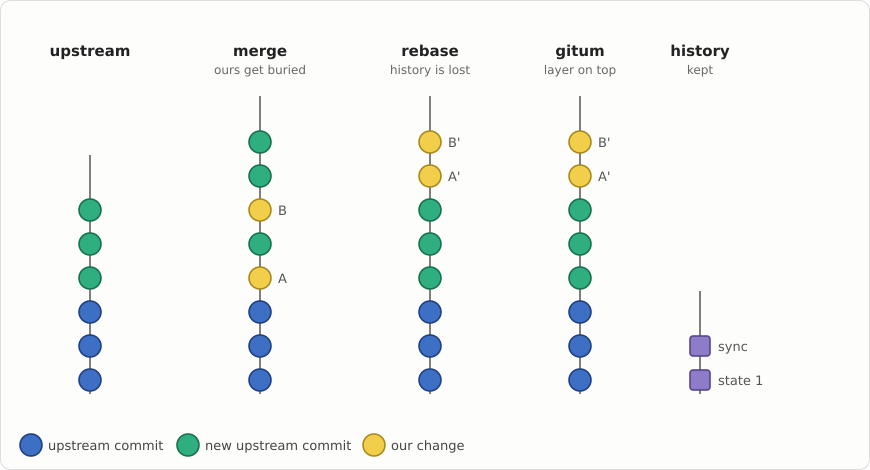
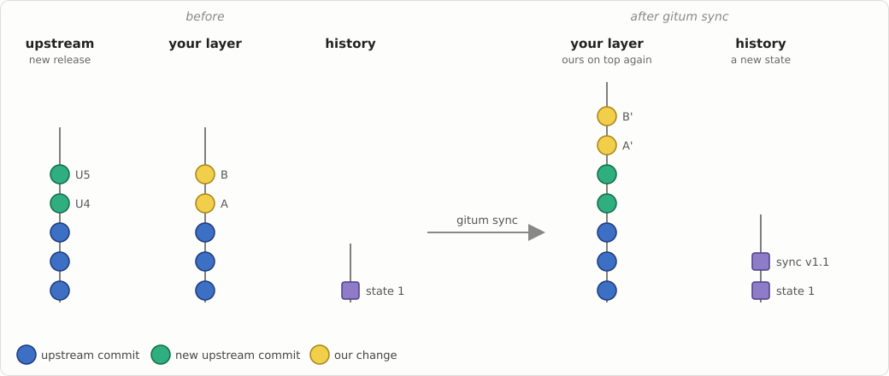
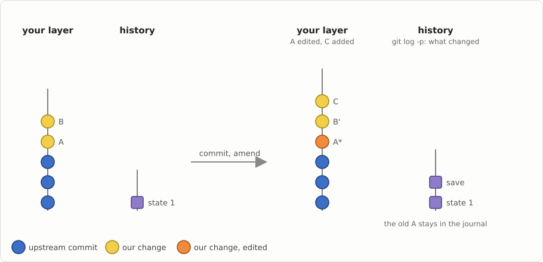
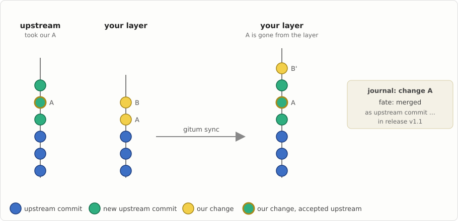

# gitum — Git Upstream Manager

*[Русская версия](README.ru.md)*

gitum keeps your own changes to somebody else's project on top of its
upstream, release after release, without merge commits and without losing
their history. At any moment you see where each of your changes stands:
only ours, sent upstream, accepted, or replaced by an upstream fix.

It is made for forks that carry many patches (like wine-rebased), for
distribution packages, and for series of changes on their way upstream.

## Why

Keeping a fork up to date with plain git means choosing between two bad
options. With merge, your changes sink into the history and get buried among
thousands of upstream commits. With rebase, they stay on top, but their
history is lost and the branch is rewritten for everybody else.



gitum gives you both: your changes stay on top, in an ordinary git branch,
and every state is recorded in a history that only grows.

## How it works

Your changes live in a **layer**, an ordinary branch on top of the upstream
(layers can be stacked). When upstream makes a release, `gitum sync` moves
your changes onto it and records a new state:



You work in the layer with plain git: commit, amend, rebase. `gitum save`
records what you did, and the old versions of your changes stay available:



When upstream accepts one of your changes, it disappears from the layer by
itself at the next sync, and gitum remembers where it went:



A conflict stops the sync without touching your branches: you resolve it and
run `gitum continue`. A crash at any moment loses nothing.

## Installation

gitum needs Python 3.11 and git 2.45, nothing else.

```sh
pip install ./gitum
```

For ALT Linux, build the package from `gitum.spec` with gear.

## Quick start

Keep a fork in sync with its upstream:

```sh
cd myproject                     # your clone, with the upstream as a remote
gitum init --upstream up=upstream/master --release-tags 'v*' --layer mine=my-branch
gitum status                     # where everything stands
gitum sync --next-release        # move your changes onto the next release
gitum continue                   # after resolving a conflict, if there was one
gitum publish                    # share the result
```

Send a series of changes upstream:

```sh
gitum series add my-fix --base upstream:up    # the branch series/my-fix
gitum prepare my-fix --push fork              # clean it up on a fresh master
gitum check-upstream series:my-fix --apply    # later: was it accepted?
```

## Documentation

- [Manual](docs/manual.md): layers, the journal, the fate of changes, series
  and the upstream queue, configuration, all commands, hooks, reliability.
- [Design and decisions](docs/design-v2.md) (in Russian).
- Project page: <https://wiki.etersoft.ru/GitUM>

## License

GPL-2.0-or-later. See [gitum/COPYING](gitum/COPYING).
