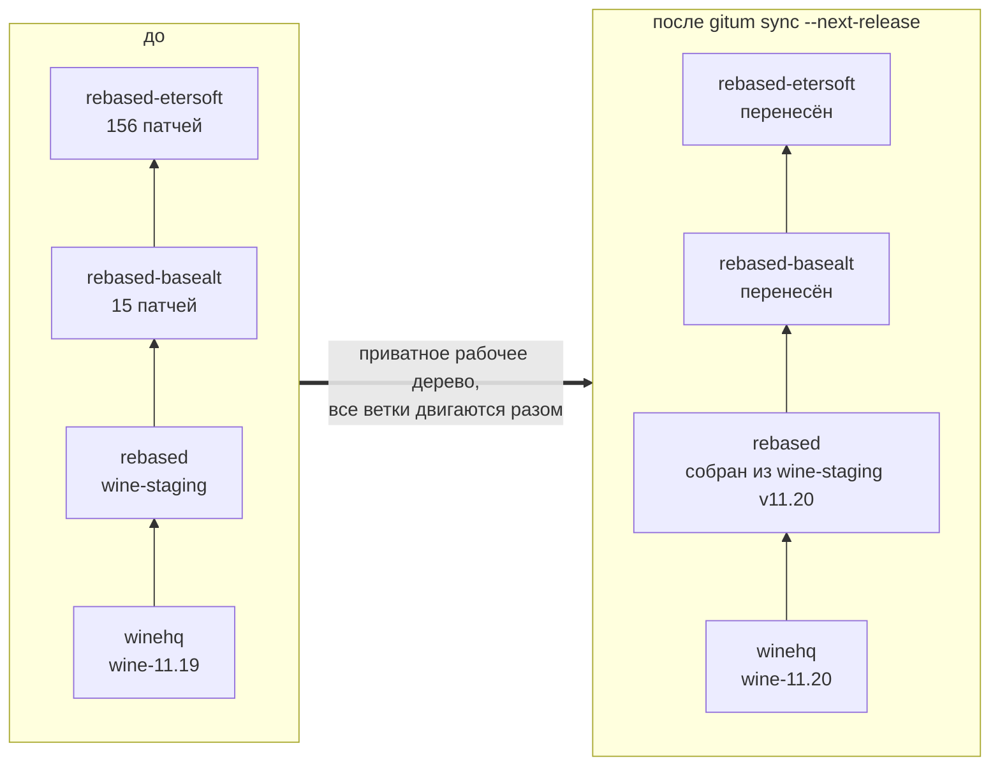
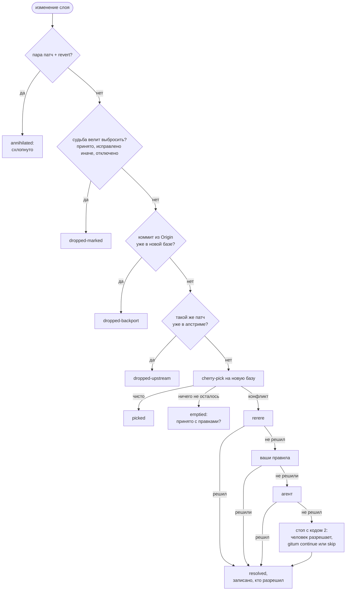
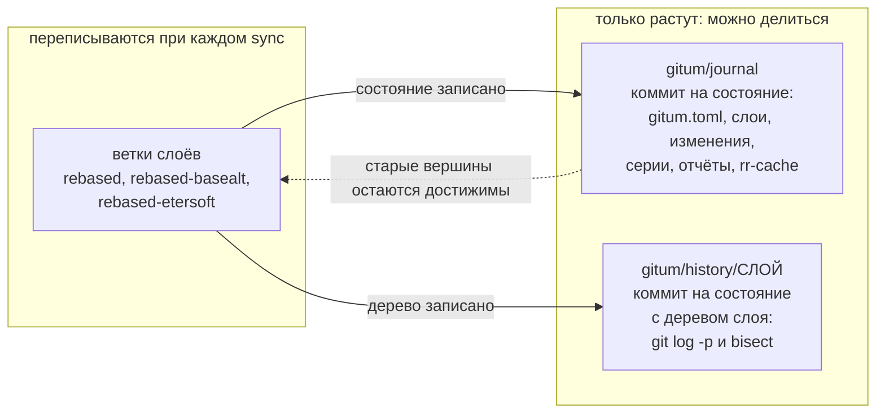
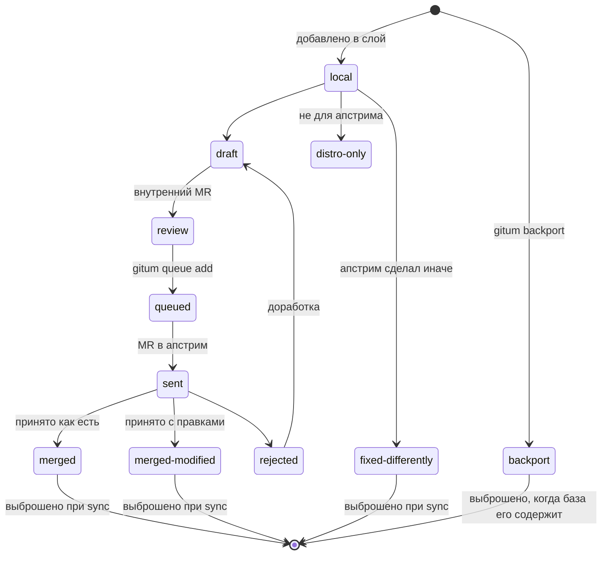
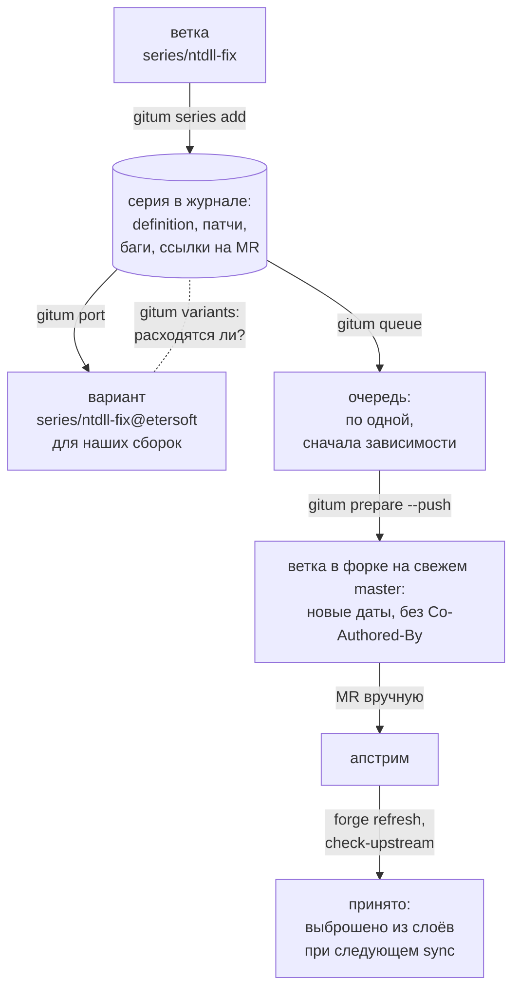

# gitum — Git Upstream Manager

*[English version](README.md)*

gitum помогает вести разработку параллельно внешнему апстриму и
синхронизироваться с ним. Он сделан для пакетов дистрибутивов, обросших
патчами, для форков с сотнями своих изменений (wine-rebased) и для серий
изменений, которые ждут приёма в апстрим. В любой момент видно, где каждое
ваше изменение находится относительно апстрима.

## Идеи

- **Слои.** Ваши изменения живут в обычных git-ветках, сложенных стопкой
  поверх апстрима, например `winehq` → `rebased` (wine-staging) →
  `rebased-basealt` → `rebased-etersoft`. Работаете с ними обычным git.
- **Синхронизация одним проходом.** `gitum sync` переносит весь стек на
  новый релиз апстрима сразу. Работа идёт в приватном рабочем дереве, а все
  ветки двигаются одним атомарным шагом в конце. Конфликт останавливает
  прогон, ничего не меняя; вы разрешаете его и продолжаете.
- **Учёт каждого изменения.** Каждое изменение классифицируется:
  применилось чисто; разрешено (и кем: rerere, ваши правила, агент,
  человек); уже есть в апстриме; выброшено как бэкпорт; выброшено по
  известной судьбе; схлопнуто как пара «патч + revert».
- **Журнал.** Ветка `gitum/journal` только дописывается: по коммиту на
  каждое опубликованное состояние. В ней базы и вершины слоёв,
  идентификаторы и судьбы изменений, серии, отчёты синхронизаций и общий
  rerere-кеш. Ветки слоёв переписываются, а журнал и ветки истории
  `gitum/history/<слой>` только растут. Поэтому ими можно безопасно
  делиться, а `git log -p` и `git bisect` работают между вашими
  состояниями.
- **У изменений есть идентичность и судьба.** gitum прослеживает изменение
  через все ребейзы, не переписывая коммиты. Судьба бывает такой: только
  наше, отправлено в апстрим (PR), принято как такой-то коммит, принято с
  правками, исправлено иначе, только для дистрибутива, бэкпорт, отключено.
  `gitum status --changes` показывает, что нужно сделать с каждым.
- **Серии.** Серия — именованный набор изменений в своей ветке, с
  зависимостями, багами, merge request'ами и состоянием. Журнал хранит
  серии в раскладке wine-staging, поэтому их можно импортировать из
  каталогов в стиле wine-staging и экспортировать в такие каталоги.

## Как это устроено

### Стек слоёв переносится на новый апстрим за один проход



Слой переносится только после успешного переноса слоя под ним. Пока весь
стек не готов, ни одна ваша ветка не меняется.

### Что происходит с каждым изменением при sync



Каждый результат попадает в отчёт прогона и в историю изменения. Результаты
резолверов, которым вы ещё не доверяете (например, агента), сначала уходят на
ревью в ветки `candidate/*`.

### Что переписывается, а что только растёт



Ветки слоёв публикуются с lease: коммиты, которые коллега тем временем
запушил, встают сверху. Журнал и ветки истории публикуются без force.
Журналы двух сессий сливаются при `gitum pull`, если те меняли разные серии
или изменения.

### Судьба изменения



`gitum check-upstream` находит принятые изменения по patch-id или по
сходству, а `gitum forge refresh` читает состояния merge request'ов.

### Путь серии в апстрим



## Требования

- Python 3.11 или новее
- git 2.45 или новее

## Установка

```sh
pip install ./gitum
```

Для ALT Linux пакет собирается из `gitum.spec` с помощью gear.

## Быстрый старт

```sh
cd wine-rebased
gitum init --upstream winehq=winehq/master --release-tags 'wine-*' \
           --layer rebased=rebased:winehq \
           --layer basealt=rebased-basealt:rebased \
           --layer etersoft=rebased-etersoft:basealt
gitum status
gitum sync --next-release        # следующий тег wine-X.Y, все слои
# при конфликте: исправить файлы в указанном рабочем дереве, git add, затем
gitum continue                   # или gitum skip / gitum abort
gitum publish                    # опубликовать слои, историю и журнал
```

`init` берёт базу каждого слоя из тега `<ветка>-START`, вершины
родительского слоя или общей базы с апстримом.

## Конфигурация

Конфигурация — файл `gitum.toml` в журнале. Посмотреть: `gitum config show`;
заменить: `gitum config load ФАЙЛ`.

```toml
version = 2

[upstream.winehq]
remote = "winehq"
ref = "winehq/master"
release-tags = "wine-*"

[layer.rebased]                 # собирается из wine-staging, а не переносится
base = "upstream:winehq"
branch = "rebased"
generator = "staging"
staging-repo = "../wine-staging"
staging-ref = "v{version}"
post-command = "autoreconf -f && tools/make_requests"

[layer.basealt]
base = "layer:rebased"
branch = "rebased-basealt"
compat-start-tag = "rebased-basealt-START"

[layer.etersoft]
base = "layer:basealt"
branch = "rebased-etersoft"
annihilate-reverts = true

[resolve]
chain = ["rerere", "rules", "agent"]
rules = "tools/conflict-resolve.py"
agent = "tools/conflict-agent.sh"
review-unless = ["rerere"]       # всё прочее — через candidate/*

[publish]
remote = "origin"
check = "./build.sh"             # должна пройти до того, как двинутся ветки

[series]
subject-lint = '^[a-z0-9_./-]+: [A-Z].*\.$'

[hooks]                          # получают JSON-события на stdin
change = "tools/notify-bugs.py"
run = "tools/notify-chat.sh"
publish = "tools/set-version-branches.sh"
```

Параметры апстрима:
- `rewritten = true`: апстрим пересоздаётся, а не продолжается, как ветка,
  собранная patchinstall.
- `prefix = "third-party/lib"`: апстрим вложен в ваше дерево (vendored).

## Команды

Все команды принимают `--json` и `--repo ПУТЬ`. Коды возврата:

| Код | Значение |
|---|---|
| 0 | успех |
| 1 | ошибка |
| 2 | нужен человек: конфликт, ревью, разошедшаяся история |
| 10 | что-то обновлено (с `--detailed-exitcode`) |
| 75 | репозиторий занят |

Интерактивных вопросов нет.

| Команда | Что делает |
|---|---|
| `init` | Создать журнал из существующих веток. Слои необязательны: для работы только с сериями достаточно апстримов. |
| `status [--changes] [--series [--variants]]` | Апстримы, слои, незавершённые операции, блокировки, таблица «изменение → судьба → действие», серии деревом по зависимостям (состояние, отставание базы, захваты, разошедшиеся варианты). |
| `sync [--to REF \| --next-release] [--step] [--candidate auto\|always\|never] [--publish] [--find-culprit] [--allow-rewrite]` | Перенести стек на новый апстрим. |
| `continue`, `skip`, `abort` | Продолжить, выбросить конфликтующее изменение или отменить остановленный sync. |
| `accept`, `drop-candidate` | Опубликовать или выбросить результат, ждущий ревью в `candidate/*`. |
| `save` | Записать работу, сделанную в ветках слоёв обычным git. |
| `publish`, `pull` | Обмен состоянием. Коммиты, запушенные другими за это время, встают сверху; журналы параллельных сессий сливаются. |
| `change list\|show\|set\|confirm` | Изменения и их судьбы: `gitum change set ID fate=merged upstream_commit=SHA`; `gitum change confirm ID [SHA]` подтверждает `suspect`, найденный `check-upstream`. |
| `check-upstream [layer:X\|series:Y] [--since REF] [--apply]` | Найти наши изменения в апстриме: patch-id, затем сходство заголовка и диффа. Совпадение считается «принято с правками», только если содержимое подтверждено (наше изменение поверх апстрима ничего не меняет); иначе — `suspect`, решает человек. |
| `series add\|save\|list\|show\|set\|remove\|export\|import-staging\|import-json\|checkout\|claim\|release` | Серии изменений. Состояния: draft → review (внутреннее ревью) → queued → sent (версия vN) → approved → merged, rejected или superseded. Серия может лежать на любой глубине каталога экспорта (`export_dir`); экспорт трогает только `definition` и те `*.patch`, которые писала сама серия, поэтому несколько серий могут делить один каталог: номера патчей продолжаются после зависимостей, а общий `definition` объединяет их Fixes. `series save ИМЯ` всегда пересчитывает названную серию. `import-json` не откатывает серию к более раннему состоянию, если она менялась позже записи (с `--force` откатывает). Первый экспорт патчей, сделанных вручную, перепишет их в нормализованном виде gitum (`From 0000…`, без подписи). `claim` отмечает, что серией занимается сессия (`GITUM_SESSION`); другие сессии получат по ней код 75. |
| `port`, `variants` | Серия на другой базе и чем её варианты отличаются. |
| `queue [next\|add\|pause\|resume] [--target T]`, `queue --format md` | Очереди отправки в апстрим, по одной на цель (поле серии `target`). По одной серии, пока её не одобрят или не примут; сначала зависимости. `pause --reason` останавливает очередь. Генерирует `UPSTREAM-QUEUE.md`; заголовки берутся из `[queue.markdown]`. |
| `prepare СЕРИЯ [--push ФОРК] [--force]` | Серия в виде для апстрима: свежая база, новые даты с шагом в секунду, без trailer'ов Co-Authored-By/Gitum-Id, проверка заголовков, перераскладка путей для vendored-деревьев, range-diff с сохранённой серией. Зависимости должны быть уже приняты (`--force` включает их коммиты). Merge request вы открываете сами; `forge refresh` предупредит, если его голова отличается от подготовленной ветки. |
| `backport SHA\|URL --into СЛОЙ` | Взять коммит апстрима с trailer'ом `Origin:`; он выбрасывается сам, когда база его содержит. |
| `branches [--remote ФОРК] [--prune]` | Ветки серий и апстрима; устаревшие после merge. |
| `forge refresh\|import-json\|export-json` | Состояния merge request'ов из GitHub, GitLab или Forgejo либо в виде JSON от ваших скриптов. |
| `export`, `import` | Наборы патчей для spec-файлов RPM (строки Patch между `# BEGIN gitum patches` / `# END gitum patches`), quilt, wine-staging. |
| `log [ИЗМЕНЕНИЕ\|series:X\|layer:X]`, `diff СОСТОЯНИЕ1 [СОСТОЯНИЕ2]`, `report [ПРОГОН] [--html ФАЙЛ]` | История и отчёты. |
| `mirror ИМЯ` | Общее зеркало апстрима в `~/.cache/gitum` вместо разовых клонов. |

## Команды, которые запускает gitum

gitum запускает ваши команды для разрешения конфликтов, проверок,
генерируемых слоёв и хуков. Все они неинтерактивны и получают одинаковое
окружение `GITUM_*`:

| Переменная | Значение |
|---|---|
| `GITUM_REPO` | основное рабочее дерево репозитория |
| `GITUM_COMMON_DIR` | общий каталог git |
| `GITUM_WORKTREE` | приватное рабочее дерево операции (только sync) |
| `GITUM_RUN`, `GITUM_RUN_DIR` | идентификатор прогона и каталог его логов |
| `GITUM_LAYER` | обрабатываемый слой |
| `GITUM_UPSTREAM`, `GITUM_TARGET`, `GITUM_TARGET_TAG`, `GITUM_VERSION` | апстрим, целевой коммит, его релизный тег и версия из тега (`wine-11.20` → `11.20`) |
| `GITUM_LOCK_FILE` | файл блокировки репозитория |
| `GITUM_LOCK_HELD` | путь к файлу блокировки, пока gitum её держит |

| Команда | Рабочий каталог | Дополнительные переменные | Результат |
|---|---|---|---|
| `resolve.rules`, `resolve.agent` | приватное дерево с конфликтом | `GITUM_COMMIT`, `GITUM_SUBJECT`, `GITUM_FILES` (по одному в строке), `GITUM_CONFLICT_DIR`, `GITUM_RESOLVER` | код 0, все конфликты разрешены и добавлены через `git add` |
| `publish.check` | приватное дерево на вершине каждого листового слоя | `GITUM_TIP` | код 0, иначе ветки не меняются |
| `generator = "command"` | приватное дерево на новой базе | `GITUM_BASE` | новые коммиты на HEAD |
| `post-command` генерируемого слоя | приватное дерево | | коммиты; остаток коммитит gitum |
| `hooks.change`, `hooks.run`, `hooks.publish` | основное рабочее дерево | `GITUM_EVENT` | JSON-событие на stdin; ошибка хука не роняет прогон |

Хуки:
- `hooks.change` получает по событию на каждое изменение, которое не
  применилось просто так.
- `hooks.run` получает весь отчёт sync (`event` — `sync` или `candidate`).
- `hooks.publish` запускается после успешного `gitum publish`. Его событие
  выглядит так:

```json
{"event": "publish", "remote": "origin", "journal": "<sha>",
 "upstreams": {"winehq": {"ref": "winehq/master", "sha": "<sha>", "tag": "wine-11.20", "version": "11.20"}},
 "layers": {"etersoft": {"branch": "rebased-etersoft", "old": "<sha до пуша>", "new": "<sha>",
                         "base": "<sha>", "start_tag": "rebased-etersoft-START"}},
 "integrated": {"etersoft": ["заголовки коммитов, поставленных сверху"]}}
```

**Блокировка** — стабильный интерфейс для ваших скриптов.
- Это эксклюзивный `flock` на `$GIT_COMMON_DIR/gitum/lock`.
- Пока она взята, в файле лежит JSON владельца:
  `{"pid", "host", "user", "session", "since"}`. Сессия берётся из
  `GITUM_SESSION`.
- Команды, запущенные gitum, получают `GITUM_LOCK_HELD`, и запущенный из
  них `gitum` не берёт блокировку повторно.

**Ветки, checked out в рабочих каталогах.** Ветка слоя, checked out в
чистом рабочем дереве, переезжает вместе с ним. Если в нём есть локальные
изменения, gitum останавливается с кодом 2 и ничего не меняет.

## Разработка

```sh
cd gitum
python3 -m pytest
python3 -m gitum --help
```

Проект и принятые решения — в [docs/design-v2.md](docs/design-v2.md).

## Ссылки

- Страница проекта: <https://wiki.etersoft.ru/GitUM>
- Статья на Хабре о gitum 1 (2013): <https://habr.com/ru/sandbox/60279/>
- Доклад на Протве 2012 (Павел Шиловский, Виталий Липатов):
  [Презентация Gitum на Протве 2012.odp](https://wiki.etersoft.ru/Файл:Презентация_Gitum_на_Протве_2012.odp)
- Исходный код: <https://github.com/Etersoft/gitum>

## Лицензия

GPL-2.0-or-later, см. [gitum/COPYING](gitum/COPYING).
