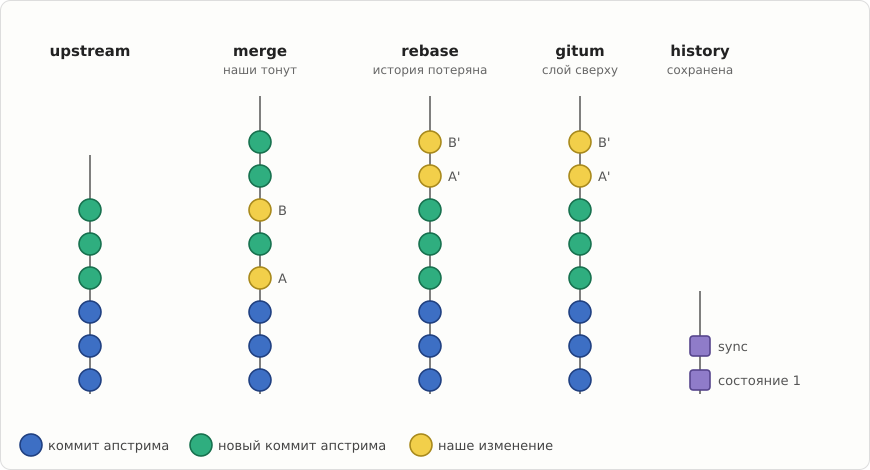
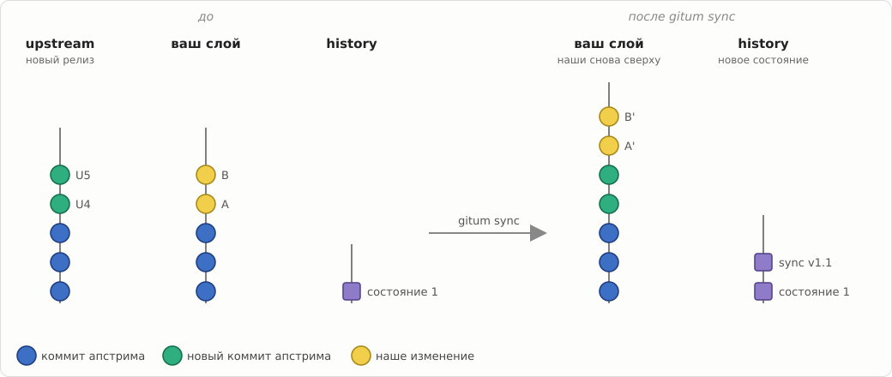
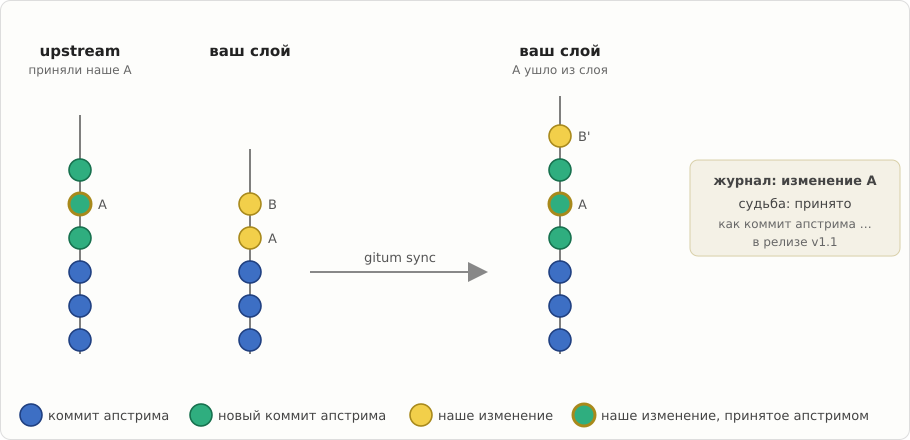

# gitum — Git Upstream Manager

*[English version](README.md)*

gitum держит ваши изменения к чужому проекту поверх его апстрима, релиз за
релизом, без merge-коммитов и без потери их истории. В любой момент видно,
что с каждым вашим изменением: только наше, отправлено в апстрим, принято или
заменено исправлением апстрима.

Он сделан для форков с множеством патчей (вроде wine-rebased), для пакетов
дистрибутивов и для серий изменений на пути в апстрим.

## Зачем

Обновлять форк обычным git — значит выбирать из двух плохих вариантов. При
merge ваши изменения уходят вглубь истории и теряются среди тысяч коммитов
апстрима. При rebase они остаются сверху, но их история теряется, а ветка
переписывается для всех остальных.



gitum даёт и то и другое: ваши изменения остаются сверху, в обычной
git-ветке, а каждое состояние записано в историю, которая только растёт.

## Как это работает

Ваши изменения живут в **слое** — обычной ветке поверх апстрима (слои можно
складывать стопкой). Когда апстрим выпускает релиз, `gitum sync` переносит на
него ваши изменения и записывает новое состояние:



В слое вы работаете обычным git: commit, amend, rebase. `gitum save`
записывает сделанное, а прежние версии ваших изменений остаются доступны:


Когда апстрим принимает одно из ваших изменений, оно само исчезает из слоя
при следующем sync, а gitum помнит, куда оно ушло:



Конфликт останавливает sync, не трогая ваши ветки: вы его разрешаете и
запускаете `gitum continue`. Падение в любой момент ничего не теряет.

## Установка

Нужны Python 3.11 и git 2.45, больше ничего.

В ALT Linux:

```sh
epm install gitum
```

Из исходников:

```sh
pip install ./gitum
```

## Быстрый старт

Держать форк в синхронизации с апстримом:

```sh
cd myproject                     # ваш клон, апстрим подключён как remote
gitum init --upstream up=upstream/master --release-tags 'v*' --layer mine=my-branch
gitum status                     # где что находится
gitum sync --next-release        # перенести ваши изменения на следующий релиз
gitum continue                   # после разрешения конфликта, если он был
gitum publish                    # поделиться результатом
```

Отправить серию изменений в апстрим:

```sh
gitum series add my-fix --base upstream:up    # ветка series/my-fix
gitum prepare my-fix --push fork              # привести её в порядок на свежем master
gitum check-upstream series:my-fix --apply    # позже: приняли ли её?
```

## Документация

- [Руководство](docs/manual.ru.md): слои, журнал, судьбы изменений, серии и
  очередь в апстрим, конфигурация, все команды, хуки, надёжность.
- [Устройство и принятые решения](docs/design-v2.md).
- Страница проекта: <https://wiki.etersoft.ru/GitUM>

## Лицензия

GPL-2.0-or-later, см. [gitum/COPYING](gitum/COPYING).
