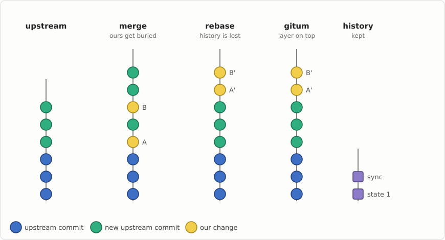
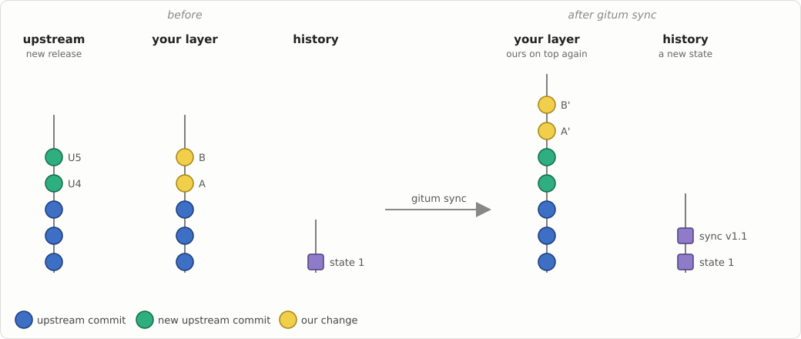
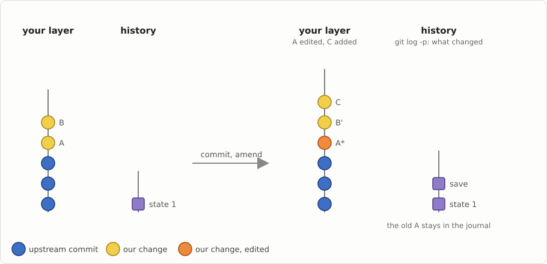
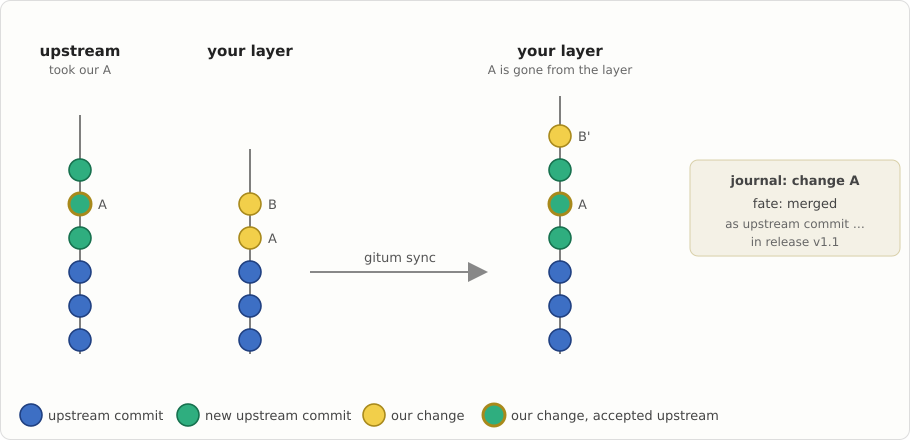
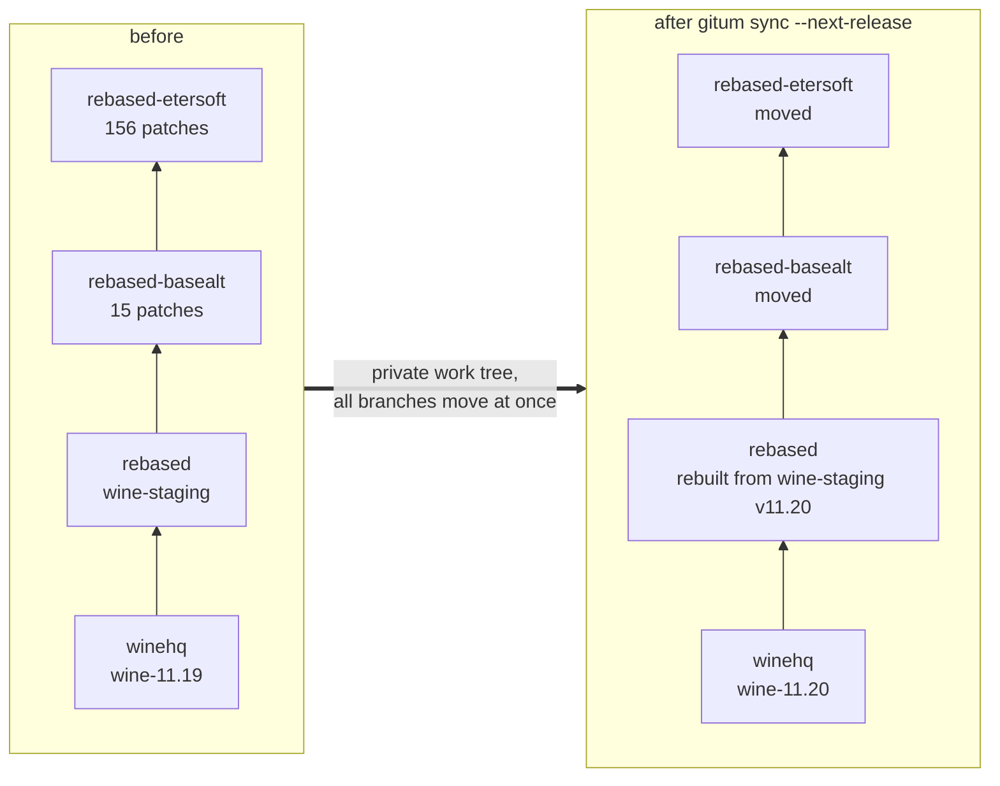
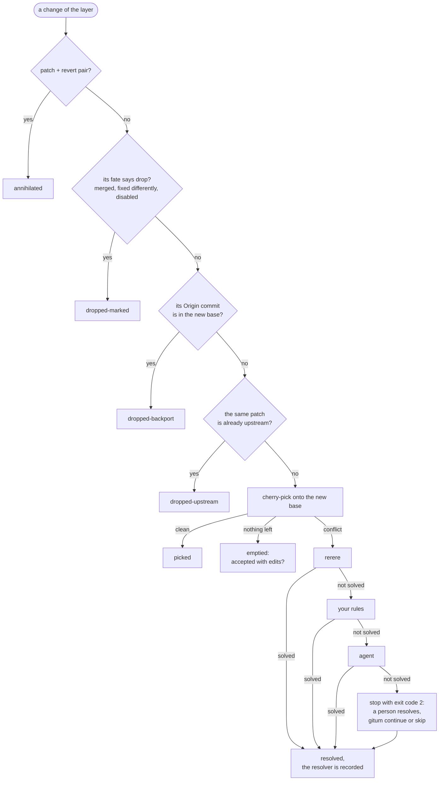
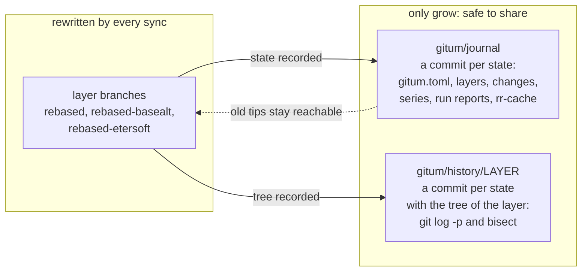
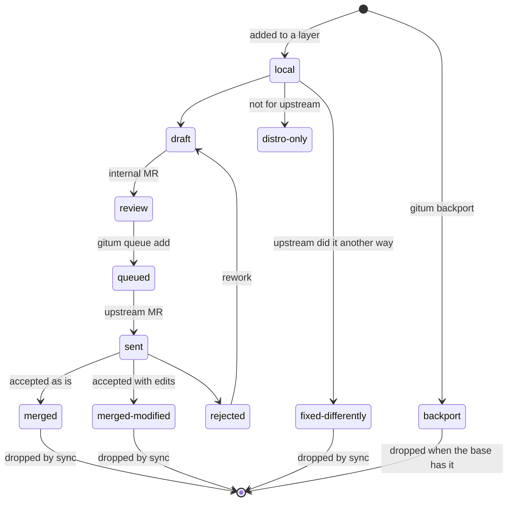
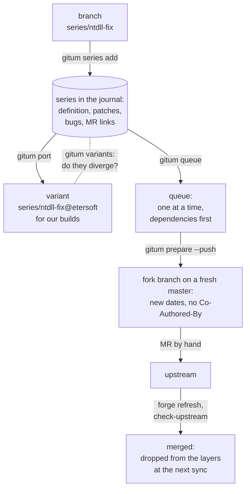

# gitum manual

*[Русская версия](manual.ru.md) · [README](../README.md)*

gitum helps you develop in parallel with an external upstream and stay in sync
with it. It is meant for distribution packages that carry patches, forks with
hundreds of local changes (wine-rebased), and series of changes waiting to be
accepted upstream. At any time it shows where each of your changes stands
relative to upstream.

## Ideas

- **Layers.** Your changes live in ordinary git branches stacked on top of
  an upstream, for example `winehq` → `rebased` (wine-staging) →
  `rebased-basealt` → `rebased-etersoft`. You work in them with plain git.
- **One-pass sync.** `gitum sync` moves the whole stack onto a new upstream
  release in one pass. It works in a private work tree, and all branches
  move in one atomic step at the end. A conflict stops the run without
  touching anything; you resolve it and continue.
- **Every change is accounted for.** Each change is classified as applied
  cleanly, resolved (and by whom: rerere, your rules, an agent, a person),
  already upstream, dropped as a backport, dropped because of its known
  fate, or removed as a patch + revert pair.
- **The journal.** The `gitum/journal` branch is append-only, with one commit
  per published state: layer bases and tips, change ids and fates, series,
  sync reports, and a shared rerere cache. The layer branches are rewritten,
  but the journal and the per-layer history branches `gitum/history/<layer>`
  only grow. That makes them safe to share, and `git log -p` and
  `git bisect` work across your states.
- **Changes have identities and fates.** gitum follows a change through every
  rebase without rewriting commits. Its fate can be: local, sent upstream
  (PR), merged as a given commit, merged with modifications, fixed
  differently, distro-only, backport, disabled. `gitum status --changes`
  shows what each change needs.
- **Series.** A series is a named set of changes on its own branch, with
  dependencies, bugs, merge requests and a state. The journal stores series
  in the wine-staging layout, so they can be imported from and exported to
  wine-staging style directories.

## Pictures

In the pictures blue dots are upstream commits, green dots new upstream commits, yellow dots our changes, purple squares the recorded states of the history branch.

Why gitum: merge buries our changes, rebase loses their history, gitum keeps both.



A new upstream release: `gitum sync` puts our changes on top again and records a new state.



Our own work with plain git (new commits, an edited old one): `gitum save` records it.



Upstream accepted one of our changes: the next sync drops it from the layer by itself.



## How it works

### A stack of layers moves to a new upstream in one pass



A layer is moved only after the layer below it has moved successfully. Until
the whole stack is done, no branch of yours changes.

### What happens to each change during a sync



Every result goes to the run report and to the history of the change. Results
from resolvers you do not trust yet (an agent, for example) first go to
`candidate/*` branches for review.

### What is rewritten and what only grows



The layer branches are pushed with a lease; commits a colleague pushed
meanwhile are put on top. The journal and the history branches are pushed
without force. The journals of two sessions merge on `gitum pull` when they
changed different series or changes.

### The fate of a change



`gitum check-upstream` finds accepted changes by patch-id or by similarity,
and `gitum forge refresh` reads merge request states from the forge.

### A series on its way upstream



## Requirements

- Python 3.11 or newer
- git 2.45 or newer

## Installation

```sh
pip install ./gitum
```

For ALT Linux, build the RPM package from `gitum.spec` with gear.

## Quick start

```sh
cd wine-rebased
gitum init --upstream winehq=winehq/master --release-tags 'wine-*' \
           --layer rebased=rebased:winehq \
           --layer basealt=rebased-basealt:rebased \
           --layer etersoft=rebased-etersoft:basealt
gitum status
gitum sync --next-release        # the next wine-X.Y tag, all layers
# on a conflict: fix the files in the printed work tree, git add, then
gitum continue                   # or gitum skip / gitum abort
gitum publish                    # push layers, history and journal
```

`init` takes the base of each layer from its `<branch>-START` tag, the tip of
the parent layer, or the merge base with the upstream.

## Scenarios

### A robot updates a fork for every release

A robot (cron) runs:

```sh
gitum sync --next-release --candidate auto --publish
```

- The staging layer is rebuilt from wine-staging of the same version; the other layers are moved.
- Conflicts that rerere knows are resolved by themselves. An agent's resolutions go to `candidate/*` for a review and are published after `gitum accept`.
- An unresolved conflict gives exit code 2: a person resolves it in the private work tree and runs `gitum continue`. After a crash, `gitum continue` resumes too.
- Hooks get JSON events: one per changed or dropped change (for bug reports) and one on publish (tag, version, old and new tips of the layers).

### A series on its way upstream

```sh
git checkout -b series/ntdll-fix winehq/master   # work on the series
gitum series add ntdll-fix --base upstream:winehq
gitum port ntdll-fix --to layer:etersoft         # a variant for our builds
gitum queue add ntdll-fix
gitum queue next                                 # what to send next
gitum prepare ntdll-fix --push fork              # a branch in the fork on a fresh master
gitum series set ntdll-fix state=sent pr=wine/wine!12345
gitum forge refresh                              # approved, merged
gitum check-upstream series:ntdll-fix --apply    # confirm the acceptance by content
```

Once the series is accepted, its changes leave the layers at the next sync and the queue moves on.

The merge request text travels with the series, images included. Write it once
(or take it from the internal merge request) and render it for each forge:

```sh
gitum mr set ntdll-fix mr.md                     # mr.md and the local images it shows
gitum mr import ntdll-fix internal:etersoft/wine!7   # or: title, text and images of an MR
gitum mr render ntdll-fix --forge upstream -o out.md # without the internal parts
```

The first line `# Title` is the title. Lines between `<!-- internal -->` and
`<!-- /internal -->` (or from `<!-- internal -->` to the end) are for internal
review only and are left out unless `--internal` is given. With `[series]
mr-internal-separator = "---"`, `mr set` and `mr import` turn the first line
`---` of a text without markers into `<!-- internal -->`, for internal merge
requests that put the review notes after such a line. The text is stored
as `series/NAME/mr.md`, the images as `series/NAME/assets/`; `series save` and
export leave them alone. For a GitLab forge with a token, `render` uploads the
images to the project (`--project`, or the project of the series' `pr`/`internal_mr`
link, or `[forge.NAME] project`, or the project of the series' upstream remote
when it is on that forge's host) and remembers their URLs by content, so a new
version of the text uploads only new or changed images. For other forges, or
with `--no-upload`, the text gets placeholders `{{gitum-asset:FILE}}` and the
images are written to `<common dir>/gitum/mr/NAME/` (or `DIR/NAME/` with
`--assets-dir DIR` or `[series] mr-assets-dir`; listed under `pending` in
`--json`); after uploading them some other way, `gitum mr record NAME
FILE=URL... --forge F` makes later renders use those URLs. gitum does not open
or edit merge requests itself: a person or an agent does that with the rendered
text.

### A distribution package

The changes of a package are commits in a layer on top of the real upstream history.
`gitum export layer:pkg --format spec --dir GEAR-REPO --spec pkg.spec` writes the patches and the Patch lines of the spec file;
`gitum import pkg.spec --into pkg` takes the existing patches of a package into the layer.

## Configuration

The configuration is `gitum.toml` in the journal. Show it with
`gitum config show`; replace it with `gitum config load FILE`.

```toml
version = 2

[upstream.winehq]
remote = "winehq"
ref = "winehq/master"
release-tags = "wine-*"

[layer.rebased]                 # rebuilt from wine-staging, not cherry-picked
base = "upstream:winehq"
branch = "rebased"
generator = "staging"
staging-repo = "../wine-staging"
staging-ref = "v{version}"
post-command = "autoreconf -f && tools/make_requests"

[layer.basealt]
base = "layer:rebased"
branch = "rebased-basealt"
compat-start-tag = "rebased-basealt-START"

[layer.etersoft]
base = "layer:basealt"
branch = "rebased-etersoft"
annihilate-reverts = true

[resolve]
chain = ["rerere", "rules", "agent"]
rules = "tools/conflict-resolve.py"
agent = "tools/conflict-agent.sh"
review-unless = ["rerere"]       # others go through candidate/*; a person (manual) is always trusted

[publish]
remote = "origin"
check = "./build.sh"             # must pass before the branches move

[series]
subject-lint = '^[a-z0-9_./-]+: [A-Z].*\.$'
bug-tracker = "etersoft"         # a bare bug number belongs to it
fixes-tracker = "winehq"         # its bugs are the Fixes: lines of a definition

[tracker.etersoft]
url = "https://bugs.etersoft.ru/show_bug.cgi?id={n}"

[tracker.winehq]
url = "https://bugs.winehq.org/show_bug.cgi?id={n}"
label = "winehq {n}"             # default: "#{n}" for bug-tracker, "{tracker} {n}" for others

[hooks]                          # get JSON events on stdin
change = "tools/notify-bugs.py"
run = "tools/notify-chat.sh"
publish = "tools/set-version-branches.sh"
series = "tools/comment-in-bugs.py"  # a series changed its state
```

Upstream options:
- `rewritten = true`: the upstream is regenerated rather than continued, like
  a branch built by patchinstall.
- `prefix = "third-party/lib"`: the upstream is vendored inside your tree.

## Commands

All commands take `--json` and `--repo PATH` (anywhere on the command line). Exit codes:

| Code | Meaning |
|---|---|
| 0 | success |
| 1 | error |
| 2 | needs a person: conflict, review, diverged history |
| 10 | something was updated (with `--detailed-exitcode`) |
| 75 | the repository is busy |

Nothing asks questions interactively.

| Command | What it does |
|---|---|
| `init` | Create the journal from existing branches. Layers are optional: for series only, give just the upstreams. |
| `status [--changes] [--series [--variants]]` | Upstreams, layers, operations in progress, locks, the "change → fate → action" table, series as a tree by dependencies (state, base lag, claims, diverged variants). |
| `sync [--to REF \| --next-release] [--step] [--candidate auto\|always\|never] [--publish] [--find-culprit] [--allow-rewrite]` | Move the stack onto a new upstream. |
| `continue`, `skip`, `abort` | Resume, drop the conflicting change, or cancel a stopped sync. |
| `accept`, `drop-candidate` | Publish or drop a result waiting for review in `candidate/*`. |
| `save` | Record work done on layer branches with plain git. |
| `publish`, `pull` | Share the state. Commits others pushed meanwhile are put on top; journals of parallel sessions merge. |
| `change list\|show\|set\|confirm` | Changes and their fates: `gitum change set ID fate=merged upstream_commit=SHA`; `gitum change confirm ID [SHA]` accepts a suspect found by `check-upstream`. |
| `check-upstream [layer:X\|series:Y] [--since REF] [--apply]` | Find our changes upstream: patch-id, then subject and diff similarity. A match counts as accepted with edits only when the content is verified (our change applied onto upstream changes nothing); anything else is `suspect` and waits for a person. |
| `series add\|save\|list\|show\|set\|remove\|export\|import-staging\|import-json\|checkout\|claim\|release` | Series of changes. States: draft → review (internal) → queued → sent (version vN) → approved → merged, rejected or superseded. A series may sit at any depth of an export directory (`export_dir`); export touches only `definition` and the `*.patch` files the series wrote itself, so several series can share a directory: patch numbers continue after their dependencies, and the shared `definition` combines their Fixes. `series save NAME` always recounts a named series. When commits of a series on `upstream:X` were committed by someone who commits to that upstream (and not by you), the branch most likely stands on a newer upstream than the local ref: `series add`, `save` and `import-json` warn and exit with 2, and `status` shows the warning until the upstream is fetched and the series saved again. `import-json` never moves a series back to an earlier state when the series changed after the record (`--force` does). The first export of hand-made patches rewrites them in gitum's normalized form (`From 0000…`, no signature). `claim` marks a series as worked on by a session (`GITUM_SESSION`); other sessions get exit code 75 for it. `pr` and `internal_mr` take a URL or `[forge:]group/project!N`, resolved through `[forge.NAME]` (defaults: `[series] pr-forge`, `internal-mr-forge`); a forge with other paths sets `mr-url = "{url}/{project}/merge_requests/{n}"`. |
| `mr set\|import\|render\|record SERIES` | The merge request text of a series with its images; internal parts; images uploaded once per forge project (see "A series on its way upstream"). |
| `bugs [[TRACKER:]N] [--format md] [-o FILE]` | The bug index: bug (a link) → its series → state and version → merge requests → release once merged, sorted by tracker and number. A series lists its bugs as `bugs=etersoft:19979,winehq:60741` (`series set`, `import-json`); a bare number belongs to `[series] bug-tracker`. With `[series] fixes-tracker`, the bugs of that tracker are written as `Fixes: [N]` lines of the definition (unless a Fixes line already names them), and `Fixes: [N]` lines read by `import-staging` or set as `fixes=` become bugs. `series list --bug B` and `status --series --bug B` show the series of one bug; the queue markdown shows bugs as links, and `sections = [..., "bugs"]` adds the index to it. |
| `port`, `variants` | A series on another base, and how its variants differ. |
| `queue [next\|add\|pause\|resume] [--target T]`, `queue --format md` | Upstream submission queues, one per target (series field `target`). One series at a time until it is approved or merged, dependencies first. `pause --reason` stops a queue. Generates `UPSTREAM-QUEUE.md`: `[queue.markdown]` sets its sections (`sent`, `queued`, `review`, `draft`, `done`), the fields shown as columns (`fields`, `done-fields`: any series field such as `reviewer`, `release`, `merged_at`) and all titles (`titles`). |
| `prepare SERIES [--push FORK] [--force]` | Upstream form of a series: fresh base, new dates one second apart, no Co-Authored-By/Gitum-Id trailers, subject check, path remapping for vendored trees, a range-diff against the saved series. Dependencies must be merged first (`--force` includes them). You open the merge request yourself; `forge refresh` warns if its head differs from the prepared branch. |
| `backport SHA\|URL --into LAYER` | Take an upstream commit with an `Origin:` trailer; it is dropped automatically once the base contains it. |
| `branches [--remote FORK] [--prune]` | Series and upstream branches; stale ones after merge. |
| `forge refresh\|import-json\|export-json` | Merge request states from GitHub, GitLab or Forgejo, or as JSON from your own scripts. |
| `export`, `import` | Patch sets for RPM spec files (Patch lines between `# BEGIN gitum patches` / `# END gitum patches`), quilt, wine-staging. |
| `log [CHANGE\|series:X\|layer:X]`, `diff STATE1 [STATE2]`, `report [RUN] [--html FILE]` | History and reports. |
| `mirror NAME` | A shared mirror of an upstream in `~/.cache/gitum` instead of throwaway clones. |

## Commands that gitum runs

gitum runs your commands for conflict resolution, checks, generated layers
and hooks. None of them is interactive. They all get the same `GITUM_*`
environment:

| Variable | Value |
|---|---|
| `GITUM_REPO` | the main work tree of the repository |
| `GITUM_COMMON_DIR` | the git common directory |
| `GITUM_WORKTREE` | the private work tree of the operation (sync only) |
| `GITUM_RUN`, `GITUM_RUN_DIR` | the run id and its log directory |
| `GITUM_LAYER` | the layer being processed |
| `GITUM_UPSTREAM`, `GITUM_TARGET`, `GITUM_TARGET_TAG`, `GITUM_VERSION` | the upstream, the target commit, its release tag and the version from the tag (`wine-11.20` → `11.20`) |
| `GITUM_LOCK_FILE` | the repository lock file |
| `GITUM_LOCK_HELD` | set to the lock file while gitum holds the lock |

| Command | Working directory | Additional variables | Result |
|---|---|---|---|
| `resolve.rules`, `resolve.agent` | the private work tree with the conflict | `GITUM_COMMIT`, `GITUM_SUBJECT`, `GITUM_FILES` (one per line), `GITUM_CONFLICT_DIR`, `GITUM_RESOLVER` | exit 0 with all conflicts resolved and `git add`ed |
| `publish.check` | the private work tree at the top of each leaf layer | `GITUM_TIP` | exit 0, or the branches stay unchanged |
| `generator = "command"` | the private work tree at the new base | `GITUM_BASE` | new commits on HEAD |
| `post-command` of a generated layer | the private work tree | | commits; leftovers are committed by gitum |
| `hooks.change`, `hooks.run`, `hooks.publish`, `hooks.series` | the main work tree | `GITUM_EVENT`; for `hooks.series` also `GITUM_SERIES`, `GITUM_STATE`, `GITUM_PREVIOUS_STATE` | JSON event on stdin; failures never fail the run |

Hooks:
- `hooks.change` gets one event per change that was not simply applied.
- `hooks.run` gets the whole sync report (`event` is `sync` or `candidate`).
- `hooks.series` runs when a series changes its state (`series set`, `queue add`, `forge refresh`, `forge import-json`): `{"event": "series-state", "series", "state", "previous", "version", "pr", "internal_mr", "upstream_commit", "release", "source", "bugs": [{"bug": "winehq:60741", "tracker", "id", "url", "label"}]}`. gitum itself never writes to bug trackers.
- `hooks.publish` runs after a successful `gitum publish`. Its event looks like this:

```json
{"event": "publish", "remote": "origin", "journal": "<sha>",
 "upstreams": {"winehq": {"ref": "winehq/master", "sha": "<sha>", "tag": "wine-11.20", "version": "11.20"}},
 "layers": {"etersoft": {"branch": "rebased-etersoft", "old": "<sha before the push>", "new": "<sha>",
                         "base": "<sha>", "start_tag": "rebased-etersoft-START"}},
 "integrated": {"etersoft": ["subjects of commits put on top"]}}
```

**The lock** is a stable interface for your own scripts.
- It is an exclusive `flock` on `$GIT_COMMON_DIR/gitum/lock`.
- While it is held, the file contains the owner as JSON: `{"pid", "host", "user", "session", "since"}`. The session comes from `GITUM_SESSION`.
- Commands run by gitum get `GITUM_LOCK_HELD`, and a `gitum` started from them does not lock again.

**Checked-out branches.** A layer branch checked out in a clean work tree
moves together with its work tree. If that work tree has local changes,
gitum stops with exit code 2 and changes nothing.

## Reliability

gitum may be interrupted at any moment — killed, out of memory, power loss —
and nothing is lost or left half-done:

- Work happens in a private work tree. Your branches move only at the end,
  all together in one atomic ref transaction, or not at all.
- Every step of a sync is recorded before it is done and can be redone:
  after a crash `gitum continue` puts the private work tree back to the
  start of the interrupted step and goes on. `gitum abort` drops the
  operation instead; your branches stay as they were.
- A clean work tree that follows a moved branch is updated before the branch
  moves and put back if the transaction fails.
- A marker file describes every commit in progress. The next gitum command
  finishes a commit that happened (cleanup, hooks) or undoes one that did not.
  It also removes private work trees left by a killed gitum.
- State files are written atomically. Branches, history and journal change
  together in one transaction, also for `backport`, `import` and the commits
  `publish` puts on top.

`gitum status` shows an interrupted operation and what to do about it. The
test suite kills gitum at many points (`GITUM_TEST_CRASH`) and checks that
`gitum continue` reaches exactly the result of an uninterrupted run.

## Development

```sh
cd gitum
python3 -m pytest
python3 -m gitum --help
```

The design and the decisions behind it are in
[docs/design-v2.md](design-v2.md) (in Russian).

## Links

- Project page (in Russian): <https://wiki.etersoft.ru/GitUM>
- Article on Habr about gitum 1 (in Russian, 2013): <https://habr.com/ru/sandbox/60279/>
- Presentation at Protva 2012 (Pavel Shilovsky, Vitaly Lipatov):
  [Presentation Gitum at Protva 2012.odp](https://wiki.etersoft.ru/Файл:Презентация_Gitum_на_Протве_2012.odp)
- Source code: <https://github.com/Etersoft/gitum>

## License

GPL-2.0-or-later. See [gitum/COPYING](../gitum/COPYING).
