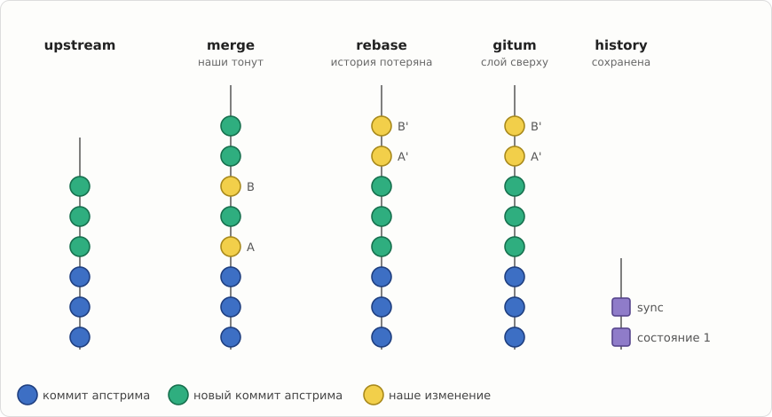
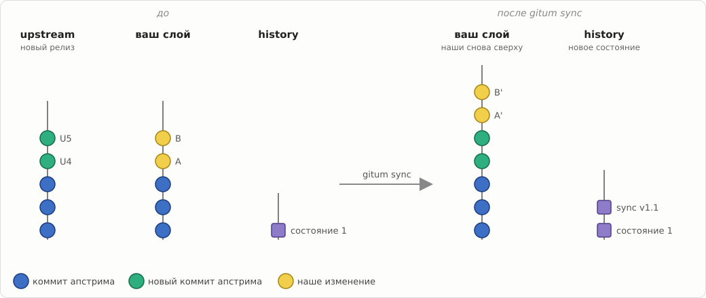
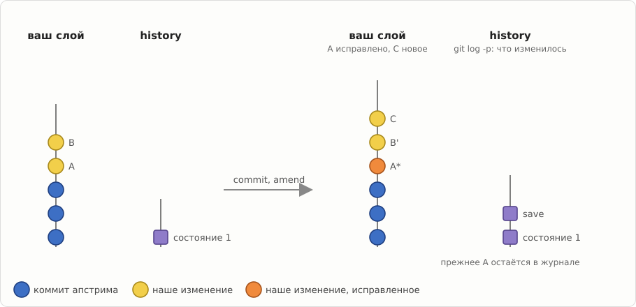
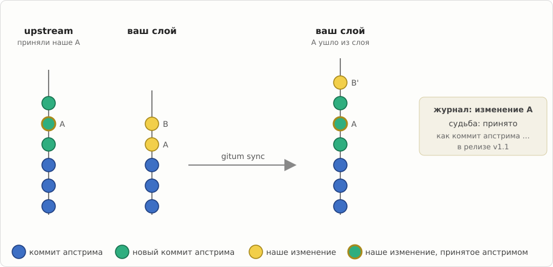
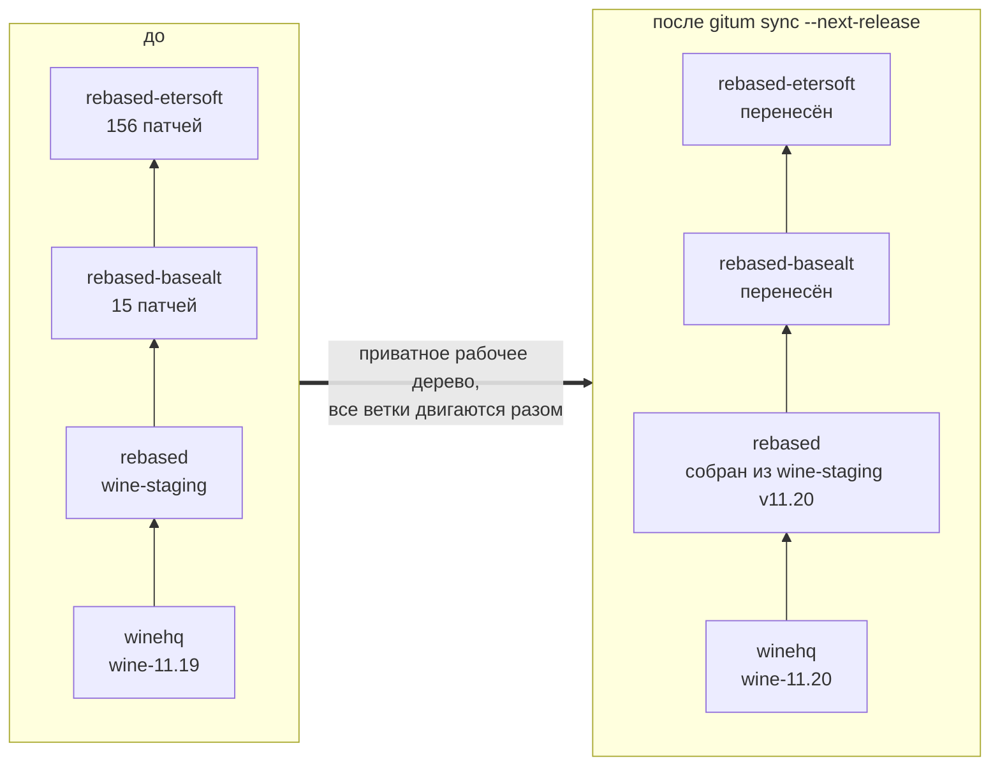
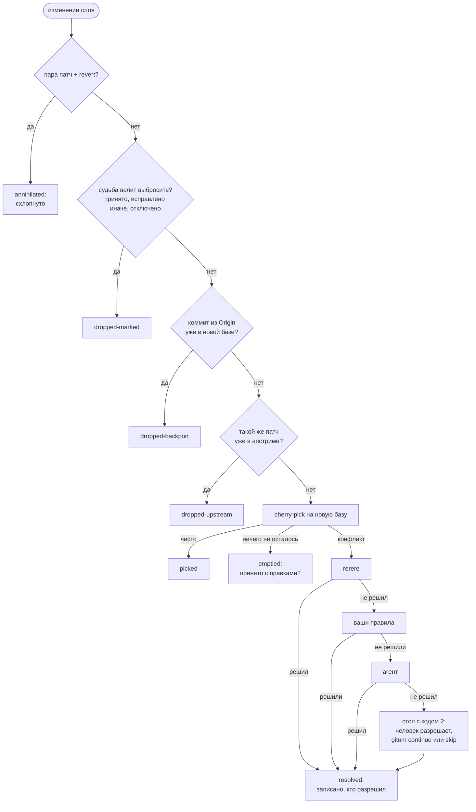
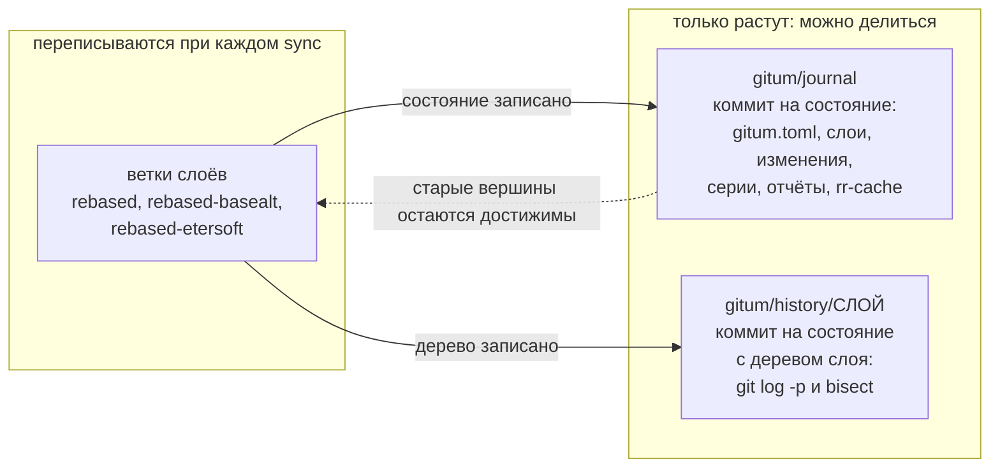
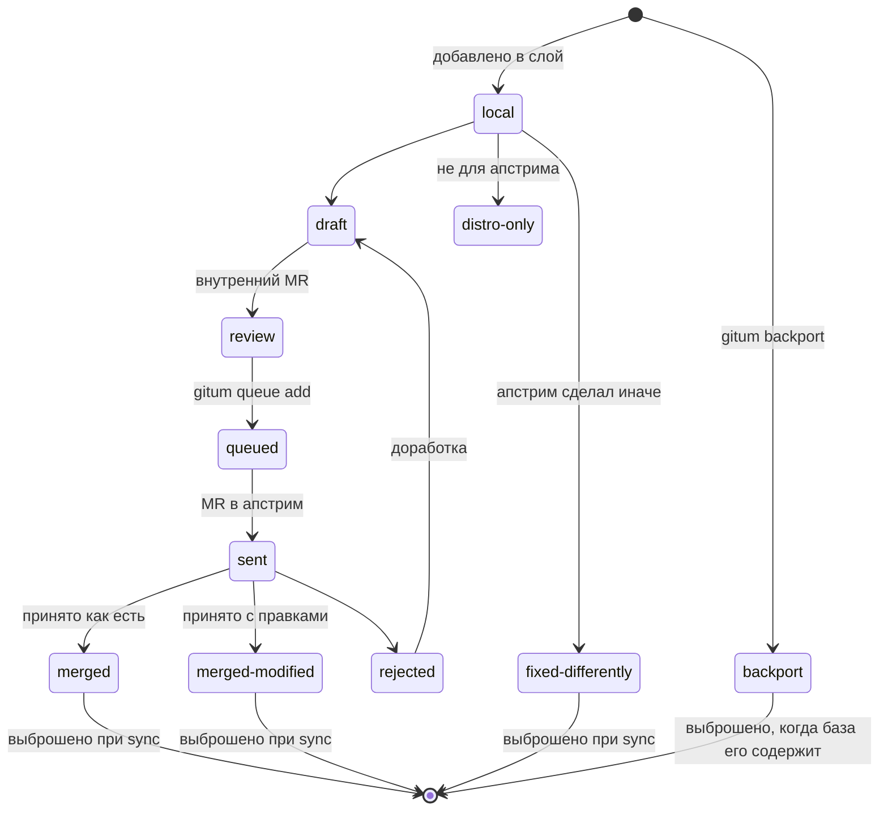
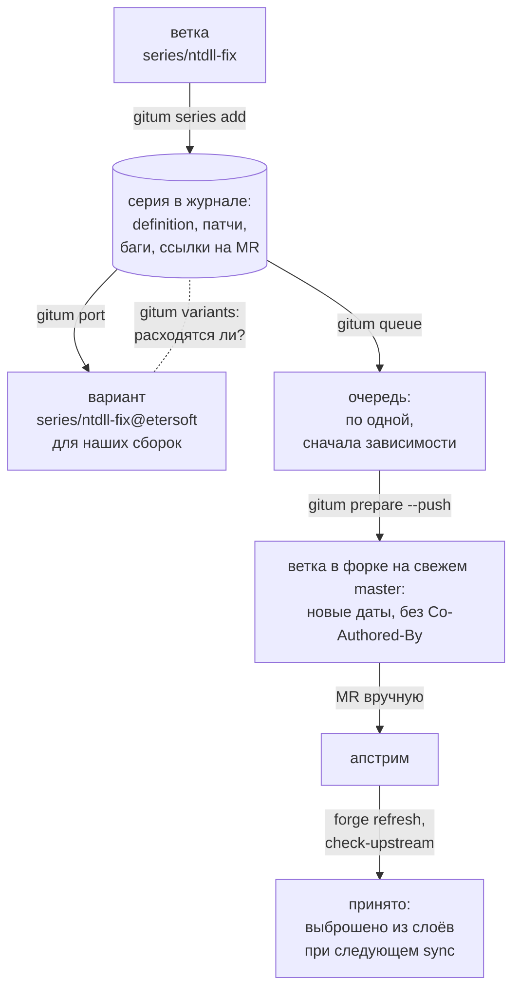

# Руководство gitum

*[English version](manual.md) · [README](../README.ru.md)*

gitum помогает вести разработку параллельно внешнему апстриму и
синхронизироваться с ним. Он сделан для пакетов дистрибутивов, обросших
патчами, для форков с сотнями своих изменений (wine-rebased) и для серий
изменений, которые ждут приёма в апстрим. В любой момент видно, где каждое
ваше изменение находится относительно апстрима.

## Идеи

- **Слои.** Ваши изменения живут в обычных git-ветках, сложенных стопкой
  поверх апстрима, например `winehq` → `rebased` (wine-staging) →
  `rebased-basealt` → `rebased-etersoft`. Работаете с ними обычным git.
- **Синхронизация одним проходом.** `gitum sync` переносит весь стек на
  новый релиз апстрима сразу. Работа идёт в приватном рабочем дереве, а все
  ветки двигаются одним атомарным шагом в конце. Конфликт останавливает
  прогон, ничего не меняя; вы разрешаете его и продолжаете.
- **Учёт каждого изменения.** Каждое изменение классифицируется:
  применилось чисто; разрешено (и кем: rerere, ваши правила, агент,
  человек); уже есть в апстриме; выброшено как бэкпорт; выброшено по
  известной судьбе; схлопнуто как пара «патч + revert».
- **Журнал.** Ветка `gitum/journal` только дописывается: по коммиту на
  каждое опубликованное состояние. В ней базы и вершины слоёв,
  идентификаторы и судьбы изменений, серии, отчёты синхронизаций и общий
  rerere-кеш. Ветки слоёв переписываются, а журнал и ветки истории
  `gitum/history/<слой>` только растут. Поэтому ими можно безопасно
  делиться, а `git log -p` и `git bisect` работают между вашими
  состояниями.
- **У изменений есть идентичность и судьба.** gitum прослеживает изменение
  через все ребейзы, не переписывая коммиты. Судьба бывает такой: только
  наше, отправлено в апстрим (PR), принято как такой-то коммит, принято с
  правками, исправлено иначе, только для дистрибутива, бэкпорт, отключено.
  `gitum status --changes` показывает, что нужно сделать с каждым.
- **Серии.** Серия — именованный набор изменений в своей ветке, с
  зависимостями, багами, merge request'ами и состоянием. Журнал хранит
  серии в раскладке wine-staging, поэтому их можно импортировать из
  каталогов в стиле wine-staging и экспортировать в такие каталоги.

## Картинки

На картинках синие точки — коммиты апстрима, зелёные — новые коммиты апстрима, жёлтые — наши изменения, фиолетовые квадраты — записанные состояния ветки истории.

Зачем gitum: при merge наши изменения тонут, при rebase теряется их история, gitum сохраняет и то и другое.



Новый релиз апстрима: `gitum sync` снова кладёт наши изменения сверху и записывает новое состояние.



Наша работа обычным git (новые коммиты, правка старого): `gitum save` её записывает.



Апстрим принял одно из наших изменений: следующий sync сам убирает его из слоя.



## Как это устроено

### Стек слоёв переносится на новый апстрим за один проход



Слой переносится только после успешного переноса слоя под ним. Пока весь
стек не готов, ни одна ваша ветка не меняется.

### Что происходит с каждым изменением при sync



Каждый результат попадает в отчёт прогона и в историю изменения. Результаты
резолверов, которым вы ещё не доверяете (например, агента), сначала уходят на
ревью в ветки `candidate/*`.

### Что переписывается, а что только растёт



Ветки слоёв публикуются с lease: коммиты, которые коллега тем временем
запушил, встают сверху. Журнал и ветки истории публикуются без force.
Журналы двух сессий сливаются при `gitum pull`, если те меняли разные серии
или изменения.

### Судьба изменения



`gitum check-upstream` находит принятые изменения по patch-id или по
сходству, а `gitum forge refresh` читает состояния merge request'ов.

### Путь серии в апстрим



## Требования

- Python 3.11 или новее
- git 2.45 или новее

## Установка

```sh
pip install ./gitum
```

Для ALT Linux пакет собирается из `gitum.spec` с помощью gear.

## Быстрый старт

```sh
cd wine-rebased
gitum init --upstream winehq=winehq/master --release-tags 'wine-*' \
           --layer rebased=rebased:winehq \
           --layer basealt=rebased-basealt:rebased \
           --layer etersoft=rebased-etersoft:basealt
gitum status
gitum sync --next-release        # следующий тег wine-X.Y, все слои
# при конфликте: исправить файлы в указанном рабочем дереве, git add, затем
gitum continue                   # или gitum skip / gitum abort
gitum publish                    # опубликовать слои, историю и журнал
```

`init` берёт базу каждого слоя из тега `<ветка>-START`, вершины
родительского слоя или общей базы с апстримом.

## Сценарии

### Робот обновляет форк на каждый релиз

Робот по cron выполняет:

```sh
gitum sync --next-release --candidate auto --publish
```

- Слой staging пересобирается из wine-staging той же версии, остальные слои переносятся.
- Конфликты, которые знает rerere, разрешаются сами. Разрешения агента уходят на ревью в `candidate/*` и публикуются после `gitum accept`.
- Неразрешённый конфликт даёт код 2: человек разрешает его в приватном дереве и запускает `gitum continue`. После падения `gitum continue` тоже продолжает работу.
- Хуки получают JSON-события: по каждому изменённому или выброшенному изменению (для отчётов в баги) и о публикации (тег, версия, старые и новые вершины слоёв).

### Серия на пути в апстрим

```sh
git checkout -b series/ntdll-fix winehq/master   # работа над серией
gitum series add ntdll-fix --base upstream:winehq
gitum port ntdll-fix --onto layer:etersoft         # вариант для наших сборок
gitum queue add ntdll-fix
gitum queue next                                 # что отправлять следующим
gitum prepare ntdll-fix --push fork              # ветка в форке на свежем master
gitum series set ntdll-fix state=sent pr=wine/wine!12345
gitum forge refresh                              # одобрено, принято
gitum check-upstream series:ntdll-fix --apply    # подтвердить принятие по содержимому
```

Когда серия принята, её изменения уходят из слоёв при следующем sync, а очередь переходит к следующей серии.

Текст merge request хранится вместе с серией, вместе с картинками. Его пишут
один раз (или берут из публичного merge request, например ещё не принятого
апстримом) и выводят для каждого forge:

```sh
gitum mr set ntdll-fix mr.md                     # mr.md и локальные картинки из него
gitum mr import ntdll-fix upstream:wine/wine!7   # или: заголовок, текст и картинки публичного MR
gitum mr render ntdll-fix --forge upstream -o out.md # без внутренних частей
```

Первая строка `# Заголовок` — это заголовок. Строки между `<!-- internal -->` и
`<!-- /internal -->` (или от `<!-- internal -->` до конца) только для
внутреннего ревью и не выводятся без `--internal`. С `[series]
mr-internal-separator = "---"` команды `mr set` и `mr import` превращают первую
строку `---` текста без маркеров в `<!-- internal -->` — для внутренних merge
request, где заметки для ревью идут после такой строки. Текст хранится в
`series/ИМЯ/mr.md`, картинки — в `series/ИМЯ/assets/`; `series save` и экспорт
их не трогают.

gitum ничего не загружает и не работает с токенами: `mr import` читает только
публичные merge request. `render` ставит вместо картинок заглушки
`{{gitum-asset:ФАЙЛ}}` и записывает картинки в `<common dir>/gitum/mr/ИМЯ/`
(или в `КАТАЛОГ/ИМЯ/` с `--assets-dir КАТАЛОГ` или `[series] mr-assets-dir`;
список `pending` в `--json`). Тот, кто открывает merge request, загружает их и
сообщает gitum URL командой `gitum mr record ИМЯ ФАЙЛ=URL... --forge F`;
следующие выводы для этого проекта forge используют их, и загружать остаётся
только новые или изменённые картинки. Проект — это `--project`, или проект из
ссылки `pr`/`internal_mr` серии на этом forge, или `[forge.ИМЯ] project`, или
проект из remote апстрима серии, если он на хосте этого forge.

### Пакет дистрибутива

Изменения пакета ведутся коммитами в слое поверх настоящей истории апстрима.
`gitum export layer:pkg --format spec --dir ГИР-РЕПО --spec пакет.spec` пишет патчи и строки Patch в spec-файле;
`gitum import пакет.spec --into pkg` забирает существующие патчи пакета в слой.

## Конфигурация

Конфигурация — файл `gitum.toml` в журнале. Посмотреть: `gitum config show`;
заменить: `gitum config load ФАЙЛ`.

```toml
version = 2

[upstream.winehq]
remote = "winehq"
ref = "winehq/master"
release-tags = "wine-*"

[layer.rebased]                 # собирается из wine-staging, а не переносится
base = "upstream:winehq"
branch = "rebased"
generator = "staging"
staging-repo = "../wine-staging"
staging-ref = "v{version}"
post-command = "autoreconf -f && tools/make_requests"

[layer.basealt]
base = "layer:rebased"
branch = "rebased-basealt"
compat-start-tag = "rebased-basealt-START"

[layer.etersoft]
base = "layer:basealt"
branch = "rebased-etersoft"
annihilate-reverts = true

[resolve]
chain = ["rerere", "rules", "agent"]
rules = "tools/conflict-resolve.py"
agent = "tools/conflict-agent.sh"
review-unless = ["rerere"]       # прочие — через candidate/*; человеку (manual) доверие всегда

[publish]
remote = "origin"
check = "./build.sh"             # должна пройти до того, как двинутся ветки

[series]
subject-lint = '^[a-z0-9_./-]+: [A-Z].*\.$'
bug-tracker = "etersoft"         # голый номер бага относится к нему
fixes-tracker = "winehq"         # его баги — строки Fixes: в definition

[tracker.etersoft]
url = "https://bugs.etersoft.ru/show_bug.cgi?id={n}"

[tracker.winehq]
url = "https://bugs.winehq.org/show_bug.cgi?id={n}"
label = "winehq {n}"             # по умолчанию "#{n}" для bug-tracker, "{tracker} {n}" для остальных

[hooks]                          # получают JSON-события на stdin
change = "tools/notify-bugs.py"
run = "tools/notify-chat.sh"
publish = "tools/set-version-branches.sh"
series = "tools/comment-in-bugs.py"  # серия сменила состояние
```

Параметры апстрима:
- `rewritten = true`: апстрим пересоздаётся, а не продолжается, как ветка,
  собранная patchinstall.
- `prefix = "third-party/lib"`: апстрим вложен в ваше дерево (vendored).

## Команды

Все команды принимают `--json` и `--repo ПУТЬ` (в любом месте командной строки). Коды возврата:

| Код | Значение |
|---|---|
| 0 | успех |
| 1 | ошибка |
| 2 | нужен человек: конфликт, ревью, разошедшаяся история |
| 10 | что-то обновлено (с `--detailed-exitcode`) |
| 75 | репозиторий занят |

Интерактивных вопросов нет.

| Команда | Что делает |
|---|---|
| `init` | Создать журнал из существующих веток. Слои необязательны: для работы только с сериями достаточно апстримов. |
| `status [--changes [--all]] [--series [--variants] [--bug Б]]` | Апстримы, слои, незавершённые операции, блокировки, таблица «изменение → судьба → действие», серии деревом по зависимостям (состояние, отставание базы, захваты, разошедшиеся варианты). |
| `sync [--to REF \| --next-release] [--step] [--candidate auto\|always\|never] [--publish] [--find-culprit] [--allow-rewrite]` | Перенести стек на новый апстрим. |
| `continue`, `skip`, `abort` | Продолжить, выбросить конфликтующее изменение или отменить остановленный sync. |
| `accept [--publish]`, `reject` | Опубликовать или выбросить результат, ждущий ревью в `candidate/*`. |
| `save [СЛОЙ...] [-m СООБЩЕНИЕ]` | Записать работу, сделанную в ветках слоёв обычным git. |
| `restore СОСТОЯНИЕ` | Вернуть весь стек (ветки, базы, теги START, точки синхронизации апстрима) к прежнему состоянию журнала из `gitum log`. Возврат записывается как новое состояние, поэтому ничего не теряется и его тоже можно отменить через `restore`. |
| `publish`, `pull` | Обмен состоянием. Коммиты, запушенные другими за это время, встают сверху; журналы параллельных сессий сливаются. |
| `change list [--layer L] [--fate F] [--all]`, `change show ID`, `change set ID[,ID...] КЛЮЧ=ЗНАЧЕНИЕ...`, `change confirm ID [SHA]` | Изменения и их судьбы: `gitum change set ID fate=merged upstream_commit=SHA`; `gitum change confirm ID [SHA]` подтверждает `suspect`, найденный `check-upstream`. |
| `check-upstream [layer:X\|series:Y] [--since REF] [--apply]` | Найти наши изменения в апстриме: patch-id, затем сходство заголовка и диффа. Совпадение считается «принято с правками», только если содержимое подтверждено (наше изменение поверх апстрима ничего не меняет); иначе — `suspect`, решает человек. |
| `series add\|save\|list\|show\|set\|remove\|checkout\|claim\|release\|export-json\|import-json` | Серии изменений. Состояния: draft → review (внутреннее ревью) → queued → sent (версия vN) → approved → merged, rejected или superseded. Серия может лежать на любой глубине каталога экспорта (`export_dir`); экспорт трогает только `definition` и те `*.patch`, которые писала сама серия, поэтому несколько серий могут делить один каталог: номера патчей продолжаются после зависимостей, а общий `definition` объединяет их Fixes. `series save ИМЯ` всегда пересчитывает названную серию. Если коммиты серии на `upstream:X` закоммичены тем, кто коммитит в этот апстрим (и не вами), ветка, скорее всего, стоит на более свежем апстриме, чем локальный ref: `series add`, `save` и `import-json` предупреждают и выходят с кодом 2, а `status` показывает предупреждение, пока апстрим не скачан и серия не сохранена заново. `import-json` не откатывает серию к более раннему состоянию, если она менялась позже записи (с `--force` откатывает). Первый экспорт патчей, сделанных вручную, перепишет их в нормализованном виде gitum (`From 0000…`, без подписи). `claim` отмечает, что серией занимается сессия (`GITUM_SESSION`); другие сессии получат по ней код 75. `pr` и `internal_mr` принимают URL или `[forge:]группа/проект!N`, который разворачивается через `[forge.ИМЯ]` (по умолчанию `[series] pr-forge`, `internal-mr-forge`); для forge с другими путями задаётся `mr-url = "{url}/{project}/merge_requests/{n}"`. |
| `mr set СЕРИЯ ФАЙЛ`, `mr import СЕРИЯ MR`, `mr render СЕРИЯ [--forge F]`, `mr record СЕРИЯ ФАЙЛ=URL... --forge F` | Текст merge request серии с картинками; внутренние части; URL картинок запоминаются для каждого проекта forge (см. «Серия на пути в апстрим»). |
| `bugs [[ТРЕКЕР:]N] [--format md] [-o ФАЙЛ]` | Индекс багов: баг (ссылкой) → его серии → состояние и версия → merge request → релиз, когда принято; по трекеру и номеру. Серия перечисляет свои баги как `bugs=etersoft:19979,winehq:60741` (`series set`, `import-json`); голый номер относится к `[series] bug-tracker`. С `[series] fixes-tracker` баги этого трекера пишутся строками `Fixes: [N]` в definition (с текстом из заголовка серии, заголовка её merge request или темы первого коммита, если строка Fixes их ещё не называет), а строки `Fixes: [N]`, прочитанные `import --format staging` или заданные как `fixes=`, становятся багами. `series list --bug Б` и `status --series --bug Б` показывают серии одного бага; markdown очереди выводит баги ссылками, а `sections = [..., "bugs"]` добавляет в него индекс. Даты в markdown выводятся в местном часовом поясе или в `[queue.markdown] timezone` (`"Europe/Moscow"` или `"+03:00"`). |
| `port СЕРИЯ --onto БАЗА`, `variants СЕРИЯ` | Серия на другой базе и чем её варианты отличаются. |
| `queue [list [--format md] [-o ФАЙЛ]]`, `queue next`, `queue add СЕРИЯ`, `queue pause [--reason R]`, `queue resume` (все с `--target T`) | Очереди отправки в апстрим, по одной на цель (поле серии `target`). По одной серии, пока её не одобрят или не примут; сначала зависимости. `pause --reason` останавливает очередь. Генерирует `UPSTREAM-QUEUE.md`: `[queue.markdown]` задаёт разделы (`sent`, `queued`, `review`, `draft`, `done`), поля-колонки (`fields`, `done-fields`: любые поля серии, например `reviewer`, `release`, `merged_at`) и все заголовки (`titles`). |
| `prepare СЕРИЯ [--push ФОРК] [--force]` | Серия в виде для апстрима: свежая база, новые даты с шагом в секунду, без trailer'ов Co-Authored-By/Gitum-Id, проверка заголовков, перераскладка путей для vendored-деревьев, range-diff с сохранённой серией. Зависимости должны быть уже приняты (`--force` включает их коммиты). Merge request вы открываете сами; `forge refresh` предупредит, если его голова отличается от подготовленной ветки. |
| `backport SHA\|URL --into СЛОЙ` | Взять коммит апстрима с trailer'ом `Origin:`; он выбрасывается сам, когда база его содержит. |
| `branches [--remote ФОРК] [--prune]` | Ветки серий и апстрима; устаревшие после merge. |
| `forge refresh\|import-json\|export-json` | Состояния merge request'ов из GitHub, GitLab или Forgejo либо в виде JSON от ваших скриптов. `refresh` читает только публичные запросы и не посылает учётных данных; закрытые читает ваш скрипт и передаёт состояния в `import-json`. Если одобрение открытого запроса прочитать не удалось, серия в состоянии `approved` остаётся одобренной. |
| `export ЧТО... --format quilt\|spec\|staging --dir КАТАЛОГ`, `import ИСТОЧНИК [--format F]` | Наборы патчей: spec-файлы RPM (строки Patch между `# BEGIN gitum patches` / `# END gitum patches`) и quilt для слоя или серии (`--into СЛОЙ` при импорте), каталоги wine-staging для серий (`export series` пишет все, `--check` только сравнивает; `import КАТАЛОГ --base БАЗА` создаёт или обновляет серии). `--clean` удаляет только патчи, записанные gitum. `--dep3` записывает судьбу каждого изменения в его патч полями DEP-3 (`Forwarded`, `Applied-Upstream`, `Origin`, `Bug`, `Bug-<Трекер>`), а `import` превращает такие поля обратно в судьбы. `--verify` накладывает записанные патчи на базу и завершается ошибкой, если они не дают в точности дерево вершины. |
| `log [ИЗМЕНЕНИЕ\|series:X\|layer:X]`, `diff СОСТОЯНИЕ1 [СОСТОЯНИЕ2]`, `report [ПРОГОН] [--format html] [-o ФАЙЛ]` | История и отчёты. |
| `mirror ИМЯ` | Общее зеркало апстрима в `~/.cache/gitum` вместо разовых клонов. |

## Команды, которые запускает gitum

gitum запускает ваши команды для разрешения конфликтов, проверок,
генерируемых слоёв и хуков. Все они неинтерактивны и получают одинаковое
окружение `GITUM_*`:

| Переменная | Значение |
|---|---|
| `GITUM_REPO` | основное рабочее дерево репозитория |
| `GITUM_COMMON_DIR` | общий каталог git |
| `GITUM_WORKTREE` | приватное рабочее дерево операции (только sync) |
| `GITUM_RUN`, `GITUM_RUN_DIR` | идентификатор прогона и каталог его логов |
| `GITUM_LAYER` | обрабатываемый слой |
| `GITUM_UPSTREAM`, `GITUM_TARGET`, `GITUM_TARGET_TAG`, `GITUM_VERSION` | апстрим, целевой коммит, его релизный тег и версия из тега (`wine-11.20` → `11.20`) |
| `GITUM_LOCK_FILE` | файл блокировки репозитория |
| `GITUM_LOCK_HELD` | путь к файлу блокировки, пока gitum её держит |

| Команда | Рабочий каталог | Дополнительные переменные | Результат |
|---|---|---|---|
| `resolve.rules`, `resolve.agent` | приватное дерево с конфликтом | `GITUM_COMMIT`, `GITUM_SUBJECT`, `GITUM_FILES` (по одному в строке), `GITUM_CONFLICT_DIR`, `GITUM_RESOLVER` | код 0, все конфликты разрешены и добавлены через `git add` |
| `publish.check` | приватное дерево на вершине каждого листового слоя | `GITUM_TIP` | код 0, иначе ветки не меняются |
| `generator = "command"` | приватное дерево на новой базе | `GITUM_BASE` | новые коммиты на HEAD |
| `post-command` генерируемого слоя | приватное дерево | | коммиты; остаток коммитит gitum |
| `hooks.change`, `hooks.run`, `hooks.publish`, `hooks.series` | основное рабочее дерево | `GITUM_EVENT`; для `hooks.series` ещё `GITUM_SERIES`, `GITUM_STATE`, `GITUM_PREVIOUS_STATE` | JSON-событие на stdin; ошибка хука не роняет прогон |

Хуки:
- `hooks.change` получает по событию на каждое изменение, которое не
  применилось просто так.
- `hooks.run` получает весь отчёт sync (`event` — `sync` или `candidate`).
- `hooks.series` запускается, когда серия меняет состояние (`series set`, `series add` в состоянии не draft, `queue add`, `forge refresh`, `forge import-json`, `check-upstream --apply`, `change confirm`, `import --format staging`): `{"event": "series-state", "series", "state", "previous", "version", "pr", "internal_mr", "upstream_commit", "release", "source", "bugs": [{"bug": "winehq:60741", "tracker", "id", "url", "label"}]}`. Сам gitum в трекеры не пишет.
- `hooks.publish` запускается после успешного `gitum publish`. Его событие
  выглядит так:

```json
{"event": "publish", "remote": "origin", "journal": "<sha>",
 "upstreams": {"winehq": {"ref": "winehq/master", "sha": "<sha>", "tag": "wine-11.20", "version": "11.20"}},
 "layers": {"etersoft": {"branch": "rebased-etersoft", "old": "<sha до пуша>", "new": "<sha>",
                         "base": "<sha>", "start_tag": "rebased-etersoft-START"}},
 "integrated": {"etersoft": ["заголовки коммитов, поставленных сверху"]}}
```

**Блокировка** — стабильный интерфейс для ваших скриптов.
- Это эксклюзивный `flock` на `$GIT_COMMON_DIR/gitum/lock`.
- Пока она взята, в файле лежит JSON владельца:
  `{"pid", "host", "user", "session", "since"}`. Сессия берётся из
  `GITUM_SESSION`.
- Команды, запущенные gitum, получают `GITUM_LOCK_HELD`, и запущенный из
  них `gitum` не берёт блокировку повторно.

**Ветки, checked out в рабочих каталогах.** Ветка слоя, checked out в
чистом рабочем дереве, переезжает вместе с ним. Если в нём есть локальные
изменения, gitum останавливается с кодом 2 и ничего не меняет.

## Надёжность

gitum можно прервать в любой момент — kill, нехватка памяти, отключение
питания, — и ничего не потеряется и не останется сделанным наполовину:

- Работа идёт в приватном рабочем дереве. Ваши ветки двигаются только в
  конце, все вместе, одной атомарной транзакцией ссылок — или не двигаются
  вовсе.
- Каждый шаг sync записывается до выполнения и может быть повторён: после
  падения `gitum continue` возвращает приватное дерево к началу прерванного
  шага и продолжает. `gitum abort` отменяет операцию; ваши ветки остаются
  прежними.
- Чистое рабочее дерево, которое следует за переносимой веткой, обновляется
  до переноса ветки и возвращается обратно, если транзакция не прошла.
- Каждая начатая фиксация описана файлом-маркером. Следующая команда gitum
  доделывает фиксацию, которая успела произойти (очистка, хуки), или
  откатывает ту, что не произошла. Она же убирает приватные деревья,
  оставленные убитым gitum.
- Служебные файлы пишутся атомарно. Ветки, история и журнал меняются вместе
  одной транзакцией, в том числе для `backport`, `import` и коммитов,
  которые `publish` ставит сверху.

`gitum status` показывает прерванную операцию и что с ней делать. Тесты
убивают gitum во многих точках (`GITUM_TEST_CRASH`) и проверяют, что
`gitum continue` приходит ровно к результату непрерванного прогона.

## Разработка

```sh
cd gitum
python3 -m pytest
python3 -m gitum --help
```

Почему gitum устроен так и какие решения приняты — в [docs/design.ru.md](design.ru.md).

## Ссылки

- Страница проекта: <https://wiki.etersoft.ru/GitUM>
- Статья на Хабре о gitum 1 (2013): <https://habr.com/ru/sandbox/60279/>
- Доклад на Протве 2012 (Павел Шиловский, Виталий Липатов):
  [Презентация Gitum на Протве 2012.odp](https://wiki.etersoft.ru/Файл:Презентация_Gitum_на_Протве_2012.odp)
- Исходный код: <https://github.com/Etersoft/gitum>

## Лицензия

GPL-2.0-or-later, см. [gitum/COPYING](../gitum/COPYING).
